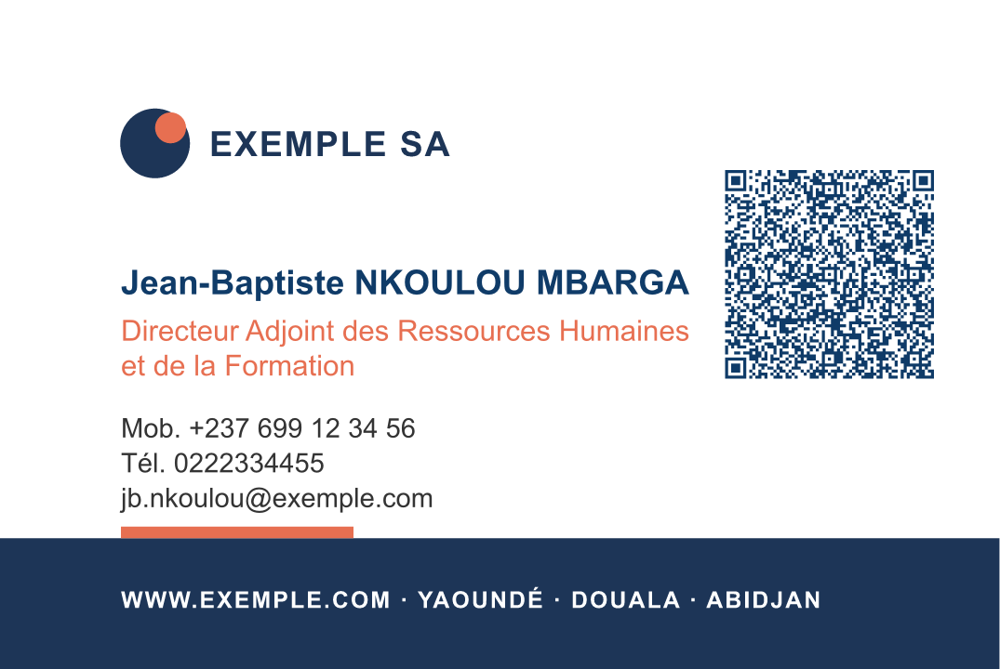
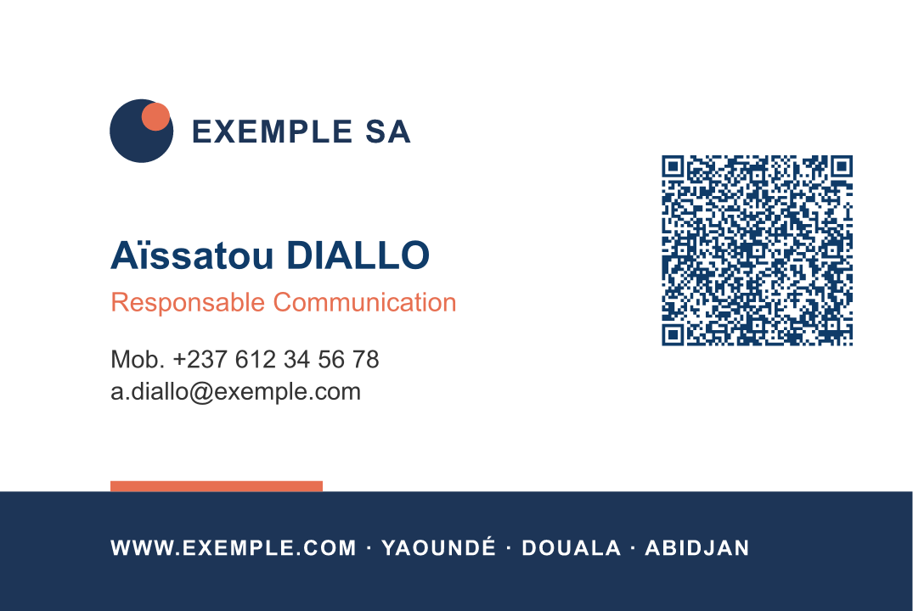
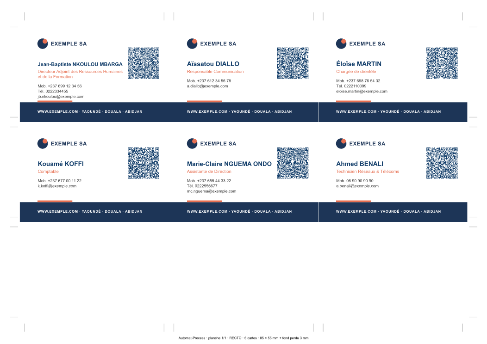
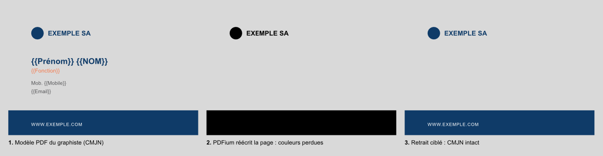

# Automat-Process — Analyse de faisabilité

**Documents personnalisés à partir d'un modèle et d'une liste : cartes de visite imprimées et numériques, signatures e-mail, documents Word**

*Version 2, 29 octobre 2026. Elle intègre les décisions prises le même jour (§ 2). Statut : validée ; phase 0 terminée, phase 1 en cours. Éditeur : Eau sèche.*

---

## 1. Synthèse

**Verdict : faisable.** Le risque technique est modéré, et un prototype a déjà validé les points les plus délicats (§ 7).

Automat-Process produit en série des **documents personnalisés** à partir d'un **modèle** et d'une **liste** (Excel). Le premier besoin, ce sont les cartes de visite ; le même socle sert ensuite aux signatures e-mail, aux visuels numériques et aux courriers Word.

Comme les utilisateurs seront **surtout des non-graphistes**, l'application est un **assistant pas à pas** :

1. On dépose le **modèle**, quel que soit son format et qu'il contienne ou non des balises.
2. On dépose la **liste**.
3. On **vérifie** les documents générés.
4. On choisit une **destination** : imprimeur, imprimante du bureau, badge PVC, signature e-mail, WhatsApp… L'application règle alors tout le reste automatiquement : couleurs, fond perdu, imposition, résolution.

Les décisions techniques importantes, déjà validées par le prototype :

- **Rendu graphique** avec Typst, un moteur de mise en page professionnel. L'aperçu est identique à l'export, le PDF reste vectoriel et en CMJN, et le moteur est rapide.
- **Lecture des balises** d'un modèle PDF ou SVG. Sur un PDF, on retire les balises **sans abîmer les couleurs**.
- **Placement manuel** des textes sur un seul visuel, appliqué ensuite automatiquement à toute la liste.
- **Pile technique** : Tauri 2, React et TypeScript, avec un cœur en Rust. Le `.exe` Windows est compilé par GitHub Actions.

---

## 2. Décisions prises (29 octobre 2026)

| Sujet | Décision | Conséquence |
|---|---|---|
| Logiciels des graphistes | Illustrator, CorelDRAW, Photoshop, Canva, GIMP et autres | Il faut accepter **tous les formats** : PDF, SVG, PNG, JPG |
| Modèles sans balises | Image vierge, PDF/SVG vierge, visuel contenant un exemple : tous les cas existent | Le **placement manuel** et le **retrait du texte d'exemple** sont indispensables |
| Impression | Imprimeur externe, imprimante A4, presse A3/SRA3, imprimante à cartes PVC | Imposition multi-formats et **impression directe** des badges |
| Utilisateurs | Surtout des non-graphistes | Assistant guidé, réglages automatiques par destination, vocabulaire simple |
| Signatures e-mail | Les trois rendus au choix : HTML avec images, image unique, HTML seul | Un générateur HTML compatible Outlook et Gmail |
| Déploiement des signatures | Copier-coller, installation automatique dans Outlook, centralisé (Microsoft 365 / Google Workspace) | Le déploiement se fait par étapes (§ 5.9) |
| Exports numériques | Carte image, fiche vCard, fond Teams/Zoom, carte numérique en ligne | Profil de sortie « écran » à côté du profil « impression » |
| Documents Word | Un `.docx` par personne, un PDF par personne, un document fusionné, fusion et séparation de PDF | Un module Word et des outils PDF |
| Première version (MVP) | **Cartes imprimées et signatures e-mail** | MVP plus long d'environ deux semaines |
| Diffusion | Usage interne d'abord, **vente ensuite** | Préparer la commercialisation dès le départ (§ 5.12) |
| Technique | **Tauri 2 + React + TypeScript + Typst** | Phase 0 lancée |
| Messageries ciblées | Microsoft 365 / Outlook, Google Workspace / Gmail, Thunderbird, webmails | Compatibilité la plus large possible |
| Hébergement des images de signature | Aucun pour l'instant | MVP : signatures HTML sans image, ou kit Outlook avec images intégrées. Le rendu « image » et les logos dans Gmail attendront un hébergement. |
| Ordre de la phase 1 | Socle commun et cartes d'abord, signatures ensuite | Les signatures réutiliseront le socle : listes, correspondances, projets |
| Langues des documents | Français, anglais, arabe, autres | Unicode complet et écriture de droite à gauche dans l'éditeur dès le départ |
| Éditeur | **Eau sèche** (+242 06 853 26 77 · gneguev@gmail.com), identifiant `com.eauseche.automatprocess` | Interface aux couleurs d'Eau sèche, logo dans « À propos » ; le produit garde son nom |
| Tests Windows | Installateur produit par GitHub Actions | Rien à installer sur le PC de test |
| Vrais fichiers de test | Dossier `exemples-reels/`, exclu de Git | Les fichiers confidentiels ne partent jamais sur GitHub |

---

## 3. Le besoin

### 3.1 Processus actuel (manuel)

1. Le graphiste conçoit le modèle dans son logiciel.
2. Il le duplique pour chaque agent et copie-colle chaque information depuis l'Excel, champ par champ.
3. Il ajuste à la main les noms trop longs, les lignes vides et les numéros.
4. Il exporte les documents un par un et les monte sur des planches pour l'impression.
5. Il relit l'ensemble, avec un risque d'erreur élevé.

Par exemple, 150 agents à environ 3 minutes par carte représentent 7 à 8 heures de travail, **pour un seul type de document**. Il faut ensuite refaire le travail pour les signatures, les badges, etc.

### 3.2 Processus cible

```
 ① Modèle              ② Liste              ③ Vérification             ④ Destination
 Déposer PDF/SVG/      Déposer l'Excel     Aperçu document par        Imprimeur · Bureau A4 ·
 PNG/JPG/DOCX/HTML     → colonnes           document + mosaïque        Presse SRA3 · Badge PVC ·
 → balises trouvées,   associées            + alertes claires          Signature e-mail · WhatsApp ·
   ou placement          automatiquement                               Fond Teams · Word/PDF
   manuel des textes
```

### 3.3 Ergonomie pour des non-graphistes

- **Une décision par écran**, sans jargon. On propose « Pour l'imprimeur » plutôt que « PDF CMJN avec fond perdu de 3 mm ».
- **Destinations prêtes à l'emploi.** Chaque destination contient déjà ses réglages techniques ; un utilisateur avancé peut les modifier.
- **Contrôles automatiques** avec des messages compréhensibles, par exemple « 3 cartes ont un nom réduit pour tenir : vérifiez-les ».
- **Modèles verrouillables.** Un graphiste ou un utilisateur avancé règle le modèle une fois ; les autres ne font que changer la liste.
- **Aide intégrée**, avec un mode d'emploi illustré pour exporter depuis chaque logiciel de conception.

---

## 4. Ce qui existe déjà

| Outil | Limites pour notre cas |
|---|---|
| InDesign, *Fusion des données* | Abonnement Adobe ; il faut préparer un CSV (pas d'Excel direct) ; outil technique, réservé aux graphistes |
| CorelDRAW, *Fusion d'impression* | Licence, manipulation fastidieuse, peu de contrôles |
| Illustrator / Photoshop, *Variables* | Complexe et peu utilisé |
| Canva, *Création en masse* | En ligne (les données des agents partent dans le cloud), abonnement, pas d'imposition ni de contrôle des données |
| Word, *Publipostage* | Bon pour les courriers, inadapté au graphisme |
| Outils de signatures (Exclaimer, CodeTwo…) | Abonnements par utilisateur ; ne gèrent que les signatures |

**Notre différence :** un seul outil pour tous les documents personnalisés. Il est **hors ligne**, sans abonnement, accessible aux non-graphistes et produit des documents **prêts pour l'imprimeur**.

---

## 5. Analyse technique

### 5.1 Modèles : formats d'entrée

| Format | Produit par | Faisabilité | Remarques |
|---|---|---|---|
| **PDF** (et `.ai` avec compatibilité PDF) | Tous les logiciels | ✅ | **Recommandé pour l'impression** : CMJN, tons directs et vectoriel conservés. Balises détectées et retirées sans dégât (validé). |
| **SVG** | Illustrator, CorelDRAW, Inkscape, Figma… | ✅ | Balises faciles à lire (validé). ⚠️ Couleurs en RVB uniquement. |
| **PNG / JPG** | Photoshop, GIMP, Canva… | ✅ | Le visuel sert de fond ; les champs sont placés à la main (§ 5.3). Il faut du 300 dpi pour l'impression ; l'application avertit si la résolution est insuffisante. |
| **DOCX** | Word | ✅ | Module Word (§ 5.10). |
| **HTML** | Signature existante | ✅ | Balises remplacées dans le HTML (§ 5.9). |
| PSD, XCF (GIMP) | Photoshop, GIMP | ⚠️ | Pas de rendu fiable des calques texte : exporter en PNG ou PDF. |
| CDR, INDD | CorelDRAW, InDesign | ❌ | Formats propriétaires : exporter en PDF ou SVG. |

### 5.2 Trois façons de définir les champs variables

| Méthode | Quand | Comment |
|---|---|---|
| **Balises** | Le graphiste a écrit `{{Nom}}`, `{{Fonction}}`, `Tél. {{Mobile}}` dans son design | Détection automatique de la police, de la taille, de la couleur et de la position ; balises retirées du fond (validé pour PDF et SVG) |
| **Clic sur le texte d'exemple** | Le design contient « Jean DUPONT » | On clique sur le texte et on choisit la colonne : le texte d'exemple est retiré et le champ reprend son style |
| **Placement manuel** | Visuel vierge, ou image où le texte fait partie des pixels | On règle les textes **sur une seule carte**, et cela s'applique à toutes (§ 5.3) |

Les trois méthodes se combinent dans un même modèle. L'application **n'est pas un logiciel de dessin** : le design reste dans l'outil du graphiste.

### 5.3 Placement manuel : régler une carte, générer toutes les autres

Ce mode est central, puisque les utilisateurs sont surtout non-graphistes et que beaucoup de modèles arrivent sans balises.

**Déroulement :**

1. **Déposer le visuel** (PNG, JPG, PDF ou SVG). L'application reconnaît sa taille et propose le format correspondant : carte 85×55 mm, signature, fond Teams… Elle avertit si la résolution ne suffit pas pour l'impression.
2. Le visuel s'affiche avec, à côté, **les colonnes de la liste et les valeurs du premier agent**.
3. **Glisser une colonne** sur le visuel. Une zone de texte apparaît avec la vraie valeur. On peut aussi dessiner une zone puis choisir la colonne, et **combiner texte fixe et colonnes** (`Tél. {{Mobile}}`, `{{Prénom}} {{NOM}}`).
4. **Réglages simples** : police (polices installées, avec aperçu), taille, gras, couleur (avec une **pipette** pour prendre une couleur du visuel) et alignement. Les réglages avancés sont repliés : interlettrage, interligne, majuscules, taille minimale, nombre de lignes maximal, ligne masquée si vide.
5. **Aides au placement** : repères magnétiques (alignement entre champs, centre du visuel), déplacement fin au clavier, cotes en millimètres ou en pixels, zone de sécurité affichée.
6. **Vérification** : on parcourt les agents (◀ ▶). Le bouton **« cas le plus long »** affiche, pour chaque champ, l'agent dont le texte est le plus long. Une **mosaïque** montre toutes les cartes.
7. Les réglages sont **enregistrés dans le modèle**. Ils s'appliquent à tous les agents et aux prochaines listes.

**Visuel contenant déjà un texte d'exemple :**

| Cas | Solution | Phase |
|---|---|---|
| PDF ou SVG | On clique sur le texte : il est retiré (méthode ciblée validée, couleurs intactes) et remplacé par un champ au même style | MVP |
| Image, fond uni sous le texte | Outil **« Effacer »** : un aplat de la couleur du fond, prise à la pipette | MVP |
| Image, fond dégradé ou photo | **Effacement intelligent** : le fond est reconstruit autour du texte | V2 |
| Image, en général | **Détection automatique du texte d'exemple** par la reconnaissance de caractères intégrée à Windows 10/11 (hors ligne). L'application propose les zones, la taille et la couleur ; l'utilisateur choisit la police. | V2 |
| Maquette avec exemple et fond vierge fournis séparément | **Calque de référence** : la maquette s'affiche en transparence pour placer les champs exactement au même endroit | MVP |

**Faisabilité :** bonne. Le moteur utilise déjà des champs à position fixe : dans le prototype, le QR code a été placé de cette manière. Le travail porte surtout sur l'**éditeur**, la plus grosse pièce d'interface du MVP. L'aperçu est calculé par le moteur lui-même, donc ce qu'on voit est exactement ce qu'on obtient.

### 5.4 Mise en page du texte variable

Ces règles valent pour les trois méthodes. Toutes sauf la dernière ont été validées par le prototype.

- **Réduction automatique** jusqu'à une taille minimale (11 → 8,8 pt sur le nom le plus long du jeu d'essai).
- **Passage sur deux lignes** si besoin ; les lignes suivantes **descendent**.
- **Ligne vide masquée**, avec son libellé ; les suivantes **remontent**.
- **Transformations** : NOM en majuscules, prénom en casse « Nom Propre », e-mail en minuscules.
- **Rapport de contrôle** par document.
- **À ajouter : une limite basse par bloc de texte** (alerte ou réduction), constatée sur la carte la plus chargée.

### 5.5 Les données (Excel)

- **Formats** : `.xlsx`, `.xls`, `.csv` (encodage détecté), `.ods`. Choix de la feuille et de la ligne d'en-tête.
- **Valeurs telles qu'affichées dans Excel**, zéros et indicatifs compris. Par exemple, `612345678` doit donner `+237 612 34 56 78` (validé).
- **Association automatique** des colonnes et des balises, sans tenir compte des accents ni de la casse, avec des synonymes (validé).
- **Nettoyage et contrôle** : espaces, e-mails et téléphones invalides, doublons, champs obligatoires vides.
- **Photos** : une colonne contenant le nom du fichier, ou un dossier où chaque photo est nommée par le matricule.

### 5.6 Le moteur de rendu graphique

Le moteur est **Typst** (open source, licence Apache-2.0, écrit en Rust), intégré directement dans l'application. Il apporte :

- une typographie professionnelle, écriture arabe comprise ;
- le **CMJN**, un PDF **100 % vectoriel** et des polices **incorporées** ;
- des fonds SVG et PDF, le CMJN des PDF étant conservé ;
- un même moteur pour le **PDF, le PNG et le SVG**, donc un **aperçu identique à l'export** ;
- environ **1 seconde pour 300 cartes** (tout est validé, § 7).

Il est encapsulé dans une couche « moteur » interne, ce qui le rend remplaçable.

### 5.7 Sorties imprimées

| Destination | Réglages appliqués automatiquement |
|---|---|
| **Imprimeur externe** | PDF CMJN, fond perdu, traits de coupe, polices incorporées ; un fichier par agent ou des planches |
| **Imprimante A4 du bureau** | Planches A4, meilleure orientation (9 cartes par A4 paysage avec fond perdu), traits de coupe, recto/verso aligné |
| **Presse A3/SRA3** | Planches A3 ou SRA3 (21 cartes par SRA3 avec fond perdu), traits de coupe, recto/verso |
| **Imprimante à cartes PVC** (Evolis, Zebra…) | Format badge CR80 (85,6 × 54 mm), une carte par page, sans traits de coupe, **impression directe** via le pilote Windows |

Restent hors de portée pour l'instant :

- la certification **PDF/X** ;
- les **tons directs (Pantone) pour les textes variables** (ceux du fond PDF sont conservés) ;
- la **vectorisation des textes** (les polices incorporées sont le standard accepté).

### 5.8 Sorties numériques (non imprimées)

Chaque modèle peut avoir **deux profils de sortie** :

| | Profil « Impression » | Profil « Écran » |
|---|---|---|
| Unités | millimètres | pixels |
| Couleurs | CMJN | RVB (sRGB) |
| Fond perdu, traits de coupe | oui | non |
| Formats | PDF, planches | PNG, JPG, WebP, PDF avec liens cliquables |
| Résolution | 300 dpi | 1× ou 2× (écrans haute définition) |

Un modèle peut aussi avoir **deux fonds** : la version imprimeur en PDF CMJN et la version écran en PNG ou SVG RVB. Sans fond écran, les couleurs sont converties automatiquement, de façon approximative.

| Export | Détail | Faisabilité |
|---|---|---|
| **Carte de visite image** | PNG ou JPG léger pour WhatsApp, LinkedIn ou l'e-mail ; version PDF cliquable (téléphone, e-mail, site) | ✅ Simple (même moteur, profil écran) |
| **Fiche contact vCard** | Un fichier `.vcf` par agent, plus un QR code qui ajoute le contact en un scan | ✅ Simple (QR validé) |
| **Fond d'écran Teams/Zoom** | Image 1920×1080 avec le nom et la fonction. Le texte doit rester hors du centre, que la personne cache. Dans **son propre** aperçu, la personne voit le texte inversé ; ses interlocuteurs le voient correctement. | ✅ Simple |
| **Carte numérique en ligne** | Une page web par agent : photo, coordonnées, bouton « Ajouter aux contacts », liens. Les pages sont générées hors ligne dans un dossier à publier sur votre site ; le QR code de la carte imprimée pointe vers elles. Il faut un hébergement et l'accord des agents, puisque les pages sont publiques. | ✅ Moyen |

### 5.9 Signatures e-mail

**Trois rendus, au choix pour chaque projet :**

1. **HTML avec images** : texte réel, numéro et e-mail cliquables, logo, photo ou bannière en image.
2. **Image unique** : une image générée par le moteur, fidèle au design. Elle n'a qu'un lien, porte un texte alternatif et reste invisible si les images sont bloquées.
3. **HTML seul** : texte mis en forme, le rendu le plus fiable.

Le modèle de signature peut être :

- une mise en page proposée par l'application, adaptée aux couleurs et au logo ;
- une **signature HTML existante** dans laquelle on place des balises ;
- un visuel de graphiste, pour le rendu « image ».

**Contraintes techniques connues et maîtrisables :**

| Contrainte | Conséquence |
|---|---|
| **Outlook classique** (Windows) affiche le HTML avec le moteur de Word | L'application génère un HTML « compatible Outlook » : mise en page en tableaux, styles écrits directement dans le code |
| **Polices** | Les polices personnalisées ne s'affichent pas partout. On utilise des polices web sûres (Arial, Verdana, Georgia…) ; seul le rendu « image » conserve la police du design. |
| **Images** | Il faut les **héberger sur une adresse web publique** (site de l'entreprise), car Gmail refuse les images intégrées au code. Exception : le kit Outlook, qui embarque les images. |
| **Gmail** | La signature est limitée à 10 000 caractères ; l'application vérifie la taille. |
| **Mode sombre** | Les logos à fond transparent doivent être testés ; l'aperçu clair/sombre est prévu. |
| **Aperçu** | L'aperçu de l'application est celui d'un navigateur. Un « test d'envoi » vers sa propre boîte est recommandé. |

**Déploiement :**

| Mode | Fonctionnement | Phase |
|---|---|---|
| **Copier-coller** | Une page par agent, avec un bouton « Copier la signature » et un mode d'emploi illustré pour Outlook (classique et nouveau), Outlook sur le web et Gmail | MVP |
| **Kit Outlook** | Par agent, un petit script qui installe la signature dans **Outlook classique** sur son PC et la définit par défaut. ⚠️ Le **nouvel Outlook** et Outlook sur le web stockent les signatures en ligne : pour eux, il faut le copier-coller ou le déploiement centralisé. | V2 |
| **Centralisé, Google Workspace** | L'administrateur autorise l'application, qui pose la signature de tous les comptes via l'interface Gmail officielle | V3 |
| **Centralisé, Microsoft 365** | Deux voies. (a) Une **règle de transport Exchange** : le serveur ajoute la signature. C'est simple, mais la signature n'apparaît pas dans les éléments envoyés et se place en bas du fil. (b) Une pose dans les signatures en ligne d'Outlook, qui passe par des interfaces peu documentées : à étudier le moment venu. | V3 |

### 5.10 Documents Word personnalisés et outils PDF

- **Modèle `.docx` avec balises `{{Nom}}`**. Les **champs de publipostage Word existants** (« Nom ») sont aussi reconnus, ce qui permet de réutiliser les modèles actuels.
- **Sorties :**
  - un `.docx` par personne, nommé automatiquement ;
  - **un PDF par personne**, via Microsoft Word installé sur le PC, piloté automatiquement pour un rendu identique à Word (sans Word : LibreOffice s'il est présent, sinon `.docx` seulement) ;
  - **un document fusionné** en `.docx` ou en PDF, pour imprimer en lot.
- **Outils PDF** : **fusionner** plusieurs PDF et **séparer** un PDF par page ou par personne, avec nommage automatique. Le test a confirmé que les pages sont copiées telles quelles, CMJN compris.
- **Piège** : Word découpe souvent le texte en morceaux, ce qui coupe une balise (`{{No` puis `m}}`). On recolle les morceaux, selon le même principe que pour le SVG (validé). La mise en forme de la balise (gras, couleur) est appliquée à la valeur.
- **Plus tard** : photos et QR codes dans Word, tableaux répétés (une ligne par élément).

### 5.11 Performances

Mesures du prototype sur un MacBook Pro Intel de 2014 :

| Opération | Durée |
|---|---|
| 300 cartes en PDF | ≈ 1,1 s |
| 300 cartes imposées sur SRA3 recto/verso | ≈ 1,1 s |
| 300 PNG à 300 dpi | ≈ 3 s |

L'aperçu se met à jour en temps réel.

### 5.12 Distribution Windows et préparation à la vente

**Distribution :**

- **Windows 10 et 11, 64 bits.** Installateur `.exe` ou `.msi`, version portable possible. Le composant WebView2 est déjà présent sur Windows 10/11 ; s'il manque, l'installateur l'ajoute.
- **Compilation automatique par GitHub Actions** : à chaque modification, un installateur Windows téléchargeable est produit. La compilation locale reste possible.
- **Mises à jour automatiques** via les publications GitHub.

**À préparer dès maintenant, pour la vente :**

- un **nom d'éditeur** et un **identifiant d'application** définitifs, puisqu'ils ne changent plus une fois publiés ;
- des dépendances sous licences permissives uniquement (MIT, Apache, BSD ; aucune dépendance AGPL) ;
- les textes de l'interface regroupés en un seul endroit, pour la traduction (français d'abord, anglais ensuite) ;
- aucune donnée ni aucun logo client inscrit dans le code ;
- une place prévue dans l'architecture pour un futur module de licence et d'activation.

**Avant la vente :** un **certificat de signature de code** (quelques centaines d'euros par an), pour éviter l'avertissement SmartScreen « Windows a protégé votre ordinateur ».

---

## 6. Architecture

```
  Modèles : PDF · SVG · PNG/JPG · DOCX · HTML          Listes : Excel · CSV · ODS
                       └──────────────────┬──────────────────┘
                                          ▼
              Socle commun (TypeScript + Rust)
              lecture des listes · nettoyage · contrôles · correspondances
              projets .automat · destinations (profils de sortie)
                                          ▼
      ┌──────────────────────┬────────────┴────────────┬─────────────────────┐
      ▼                      ▼                         ▼                     ▼
 Moteur graphique       Générateur HTML          Générateur Word        Outils PDF
 (Typst intégré)        signatures, pages        .docx ; PDF via Word   fusion, séparation
 cartes, badges,        de cartes en ligne
 visuels écran, QR
      └──────────────────────┴────────────┬────────────┴─────────────────────┘
                                          ▼
  Sorties : PDF · planches · PNG/JPG/WebP · SVG · HTML · .vcf · .docx · ZIP
  Diffusion : dossier · impression directe (A4, PVC) · kit Outlook · M365 / Workspace
```

| Brique | Choix |
|---|---|
| Application de bureau | **Tauri 2**. Exécutable léger, cœur en **Rust**, multiplateforme (une version macOS sera possible plus tard). |
| Interface | **React + TypeScript**, avec la bibliothèque de composants **Mantine** : assistant par étapes, dépôt de fichiers, choix de couleurs… |
| Moteur graphique | **Typst**, intégré comme bibliothèque Rust |
| Listes Excel | **SheetJS** (version du site officiel) |
| Modèles PDF | **PDFium** pour la détection et la fusion ou séparation ; retrait ciblé des balises dans le flux PDF |
| Word | Lecture et écriture directes du format `.docx` ; conversion PDF via Microsoft Word |
| Projet `.automat` | Archive contenant les fonds, les champs, les réglages, les correspondances et les destinations. Les données personnelles ne sont **pas** copiées par défaut. |

---

## 7. Prototype de validation

Le prototype se trouve dans le dossier [`prototype/`](../prototype/README.md). C'est du code jetable. Les fichiers de test sont des **imitations** ; **il reste à refaire le test avec de vrais fichiers de graphistes.**

| Point testé | Résultat |
|---|---|
| Balises dans un SVG de type Illustrator : styles CSS, noms PostScript, balise coupée en deux | ✅ |
| Excel : valeur affichée récupérée (zéros, indicatif) | ✅ |
| Association automatique de `{{Email}}` avec « E-mail » ; nettoyage des données | ✅ |
| Réduction automatique, passage sur 2 lignes, ligne vide masquée, rapport de contrôle | ✅ |
| QR code vCard vectoriel en CMJN | ✅ |
| Fond SVG vectoriel ; fond PDF dont le CMJN est conservé ; polices incorporées | ✅ |
| Imposition A4/SRA3 : orientation automatique, traits de coupe, verso en miroir | ✅ |
| 300 cartes : ≈ 1 s en PDF, ≈ 3 s en PNG 300 dpi | ✅ |
| Modèle PDF : détection des balises avec PDFium | ✅ |
| Modèle PDF : retrait des balises par réécriture de la page (PDFium) | ❌ Couleurs détruites |
| Modèle PDF : **retrait ciblé** des seules instructions de texte | ✅ CMJN intact, méthode retenue |
| Fusion et séparation de PDF (PDFium) | ✅ CMJN intact |



*Le nom est réduit à 8,8 pt, la fonction passe sur deux lignes, les coordonnées descendent d'autant et un QR code vCard est ajouté.*



*Sans téléphone fixe, la ligne « Tél. » disparaît et l'e-mail remonte.*



*Planche A4 recto : 6 agents sur 9 emplacements, avec traits de coupe.*



*Retrait des balises d'un modèle PDF : la méthode naïve détruit les couleurs, la méthode ciblée les conserve.*

Les PDF d'exemple peuvent être ouverts dans Acrobat ou Illustrator :

- [`exemples/cartes-unitaires.pdf`](exemples/cartes-unitaires.pdf)
- [`exemples/planches-A4-recto-verso.pdf`](exemples/planches-A4-recto-verso.pdf)

---

## 8. Risques et parades

| Risque | Impact | Parade |
|---|---|---|
| Les vrais exports (Illustrator, CorelDRAW, Canva…) diffèrent des imitations | Élevé | Tester de vrais fichiers dès que possible ; le placement manuel sert de solution de secours |
| Ergonomie trop technique pour des non-graphistes | Élevé | Assistant, destinations prêtes à l'emploi, tests avec de vrais utilisateurs à chaque phase |
| Périmètre large (cartes, signatures, numérique, Word) | Élevé | Livraison par phases ; socle commun réutilisé par tous les modules |
| Signatures mal affichées dans Outlook | Moyen | HTML « compatible Outlook », bibliothèque de mises en page testées, test d'envoi |
| Déploiement centralisé Microsoft 365 | Moyen | Copier-coller et kit Outlook d'abord ; voie centralisée étudiée en phase 3 |
| PDF Word sans Microsoft Word installé | Moyen | Repli sur LibreOffice, sinon `.docx` seul |
| Texte incrusté dans une image (fond complexe) | Moyen | Demander la version vierge, effacement sur fond uni, effacement intelligent en V2 |
| Couleurs : SVG en RVB, conversion écran/impression | Moyen | Deux fonds par modèle (impression et écran) ; PDF recommandé pour l'impression |
| Polices absentes, licences | Moyen | Détection, police embarquée dans le projet, alerte |
| Avertissement SmartScreen | Moyen | Signature de code avant la vente |
| Évolutions de Typst | Faible | Version figée, couche « moteur » |

---

## 9. Catalogue des fonctionnalités

Phases : **MVP** = première version, **V2** = version Pro, **V3** = commercialisation et plateforme. ✅ = validé par le prototype.

### Socle et ergonomie

| Fonctionnalité | Phase |
|---|---|
| Assistant en 4 étapes, destinations prêtes à l'emploi, vocabulaire simple | MVP |
| Projet `.automat` réutilisable ; modèles verrouillables (mode opérateur) | MVP |
| Association automatique des colonnes ✅, nettoyage ✅, contrôle avant export | MVP |
| Aperçu document par document, mosaïque, bouton « cas le plus long » | MVP |
| Générer l'Excel vide à partir des balises du modèle (à envoyer aux RH) | V2 |
| Mise à jour incrémentale (seulement les nouveaux et les modifiés) ; colonne Quantité | V2 |
| Interface en anglais, mises à jour automatiques | V2 |
| Licences et activation, signature de code, version macOS | V3 |

### Modèles

| Fonctionnalité | Phase |
|---|---|
| Import PDF, SVG, PNG, JPG ; balises détectées ✅ et retirées sans dégât ✅ | MVP |
| **Placement manuel** : glisser une colonne, pipette, repères, calque de référence | MVP |
| Clic sur un texte d'exemple (PDF/SVG) ; outil « Effacer » sur fond uni | MVP |
| Ajustement automatique du texte ✅, lignes vides masquées ✅, limite basse des blocs | MVP |
| Deux fonds par modèle (impression et écran) | MVP |
| Détection du texte d'exemple par reconnaissance de caractères ; effacement intelligent | V2 |
| Variantes selon une colonne (filiale, langue…) ; verso variable ; photos avec recadrage | V2 |

### Impression

| Fonctionnalité | Phase |
|---|---|
| PDF imprimeur (CMJN, fond perdu, traits de coupe) ✅ | MVP |
| Planches A4, A3, SRA3 ou format libre, orientation automatique, recto/verso ✅ | MVP |
| Badges PVC CR80 et impression directe | MVP |
| QR code vCard ✅ ; codes-barres | MVP / V2 |
| BAT filigrané « BON À TIRER » ; profils d'export personnalisés | V2 |

### Numérique

| Fonctionnalité | Phase |
|---|---|
| Carte de visite image (PNG/JPG), PDF cliquable | MVP |
| Fiche vCard `.vcf` par agent | MVP |
| **Signatures e-mail** : trois rendus, copier-coller, aperçu clair/sombre, contrôle de taille | MVP |
| Kit d'installation Outlook classique | V2 |
| Fond d'écran Teams/Zoom | V2 |
| Carte numérique en ligne (pages à publier) | V2 |
| Signatures centralisées Google Workspace et Microsoft 365 | V3 |

### Word et PDF

| Fonctionnalité | Phase |
|---|---|
| `.docx` par personne, champs de publipostage Word reconnus | V2 |
| PDF par personne (via Word), document fusionné | V2 |
| Fusion et séparation de PDF ✅ | V2 |
| Photos, QR codes et tableaux répétés dans Word | V3 |

---

## 10. Feuille de route

Durées **indicatives**, en temps de développement assisté.

| Phase | Contenu | Durée |
|---|---|---|
| **0. Socle** (en cours) | Application Tauri + React, moteur Typst intégré, aperçu et export d'une carte de démonstration, build Windows automatique | ≈ 1 semaine |
| **1. MVP** | Cartes imprimées (modèles, balises, placement manuel, Excel, contrôle, PDF/PNG, planches, PVC), carte image et vCard, **signatures e-mail** (trois rendus, copier-coller) | ≈ 5 à 7 semaines |
| **2. Version Pro** | Module Word et outils PDF, kit Outlook, fond Teams/Zoom, carte en ligne, reconnaissance de caractères et effacement intelligent, variantes, BAT, mise à jour incrémentale, interface anglaise | ≈ 5 à 6 semaines |
| **3. Commercialisation** | Signatures centralisées (Workspace, 365), licences et activation, signature de code, version macOS, autres documents (badges d'événement, attestations…), automatisation (dossier surveillé) | Selon les priorités |

---

## 11. Points encore ouverts

1. **Fichiers réels** à déposer dans `exemples-reels/` : deux ou trois modèles par logiciel, un Excel anonymisé, une signature e-mail existante et un modèle Word. C'est le test le plus important.
2. **Hébergement web**, le moment venu, pour les images des signatures (rendu « image », logos dans Gmail) et les cartes en ligne.
3. **Modèles d'imprimantes PVC** utilisées, pour tester l'impression directe.
